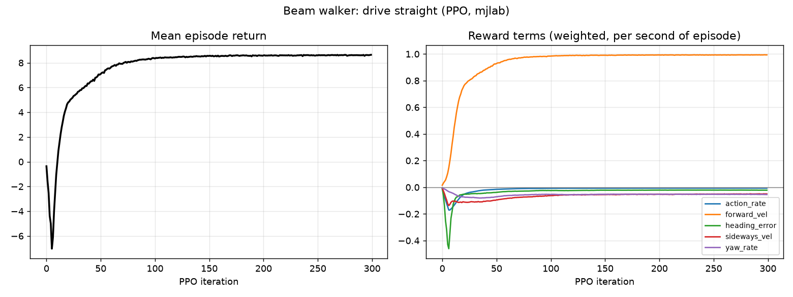

# beam-walker

ME193 robotics project. A LEGO Education Double Motor (45651) has a LEGO Technic beam on each output shaft
in place of a wheel. Turning the beams makes the robot shuffle (walk) along the floor. It doesn't walk
straight on its own: on a hard floor it always drifts left, by 1 to 36 cm in 5 s.

The project:
1. models the robot in MuJoCo and fits the model to tape-measured walks on a hard floor;
2. trains a drive-straight policy with [mjlab](https://github.com/mujocolab/mjlab) (PPO) on the Tufts HPC,
   using only what the real robot can sense and randomizing the left/right differences;
3. runs the trained policy on the real robot over Bluetooth and compares it with plain equal-speed driving.

## Results

**Real robot, hard floor** (details: [docs/sim_vs_real.md](docs/sim_vs_real.md)). The policy runs lasted 10 s
and the baseline runs 5 s, so drift is compared as a share of distance walked.

| | Trained policy (3 runs, 10 s) | Baseline: both motors 50% (3 runs, 5 s) |
|---|---|---|
| Forward | 95, 90, 89 cm (9.1 cm/s) | 67, 48, 67 cm (12.1 cm/s) |
| Drift | 11, 10, 10 cm | 16, 36, 1 cm (left) |
| Drift ÷ distance | **11%** (11.6, 11.1, 11.2%) | **29%** (24, 75, 1.5%) |

- The policy drifts about 2.6× less per distance walked and is far more repeatable, but walks about 25% slower.
- Open issues: the direction of the policy's drift wasn't recorded (IMU headings suggest it may now
  overcorrect to the right), and 1 of 5 logged policy runs ended turned around (−118°).

**Simulation** (GPU run [`results/train_walker-20261116-191801/`](results/train_walker-20261116-191801/),
2048 envs × 300 PPO iterations, 9 min on an A100). On a deliberately lopsided test robot, 10 s:

| | Policy | Baseline (both motors 50%) |
|---|---|---|
| Forward | 154.1 cm | 140.9 cm |
| Sideways drift | **+4.7 cm** | +59.8 cm |
| Final heading | **+0.9°** | +24.9° |

Videos: [rollout_policy.mp4](results/train_walker-20261116-191801/rollout_policy.mp4),
[rollout_baseline.mp4](results/train_walker-20261116-191801/rollout_baseline.mp4).



**Sim-to-real fit** ([docs/sim_vs_real.md](docs/sim_vs_real.md)): at 25% and 50% the fitted model is within 20%
of the real distance, and its leg revolutions are within 3% of the encoders. At 100% the sim goes 2× too far:
the real robot loses the extra leg turns to slipping or hopping. So the policy's commands are capped at 60%.

## How it works

- **Model** (`models/walker.xml`): chassis on a free joint, two leg hinges, velocity actuators at the measured
  max speed (17.42 rad/s = 166.3 RPM), measured total mass (97 g). Friction on the chassis/hubs/beams (0.3)
  and the torque limit (0.032 N·m) are fitted to hard-floor walks; foot friction is 0.8.
- **Observations** (real sensors only): leg angles as sin/cos and leg speeds (encoders), the last command, and
  the Double Motor's IMU: gyro z and heading error since the start.
- **Actions**: two motor speeds, capped at 60% of max.
- **Rewards**: forward speed (capped at 0.12 m/s), minus penalties for sideways velocity, heading error,
  yaw rate and command changes. Each term is logged separately.
- **Termination**: tilt over 70° (flipped) or 10 s.
- **Randomized each episode, each side separately**: foot friction 0.5–1.1, motor speed gain ±15%, torque limit
  ±20%; plus chassis mass ±15% and starting leg angles ±10°.
- **Real-robot timing** ([docs/real_robot_io.md](docs/real_robot_io.md)): a confirmed Bluetooth motor command
  takes about 60 ms, so the real control loop runs at ~16 Hz. The sim policy runs at 16.1 Hz with a random 0–1
  step command delay.
- **Units**: the IMU reports yaw in 0.1° and gyro in deg/s; `policy_io.json` records the conversions.

## Layout

| Path | What |
|---|---|
| `models/walker.xml` | MuJoCo model (fitted values documented at the top of the file) |
| `train/walker_task.py` | mjlab task `BeamWalker-DriveStraight`: observations, rewards, terminations, randomization |
| `train/train_walker.py` | Trains with PPO, then writes the checkpoint, TorchScript/ONNX policy, `policy_io.json`, reward plot and rollout videos |
| `scripts/run_policy.py` | **Moves the robot.** Runs a trained policy at ~16 Hz (or `--baseline` 50%), logs to `data/policy_run_<time>.csv` |
| `scripts/real_walk_test.py` | **Moves the robot.** Walks at 25/50/100% for 5 s, logs leg angles; `--calibrate-home`, `--home` |
| `scripts/imu_rate_check.py` | **Moves the robot.** Measures the real control-loop rate and the IMU units |
| `scripts/measure_motor.py` | **Moves the motors.** No-load RPM at 50%/100% (legs off the ground) |
| `scripts/sim_check.py` | Sim sanity test: both motors at one speed, prints x/y/yaw, writes `videos/sim_check.mp4` |
| `scripts/lego_common.py` | Double Motor connection (card 0999, ORANGE), per-side directions, homing, logging |
| `results/` | GPU training run: policy files, reward curves, rollout videos, checkpoints, Slurm log |
| `data/` | Real-robot measurements: motor RPM, hard-floor walks, IMU checks, policy runs, leg home calibration |
| `docs/` | [sim_vs_real.md](docs/sim_vs_real.md), [real_robot_io.md](docs/real_robot_io.md), [training_notes.md](docs/training_notes.md) |
| `requirements.txt` | Robot / sim venv (Python 3.14): MuJoCo 3.11.0, legoeducation, onnxruntime |
| `requirements-mjlab.txt` | Training venv (Python 3.13), same versions as the cluster |

## How to run

### Setup

```bash
python3 -m venv .venv && .venv/bin/pip install -r requirements.txt     # robot + sim (Python 3.14 is fine)
# Training venv, only for local tests (mjlab 1.6.0 needs Python 3.11-3.13):
uv venv --python 3.13 .venv-mjlab && uv pip install --python .venv-mjlab/bin/python -r requirements-mjlab.txt
```

### Simulation check

```bash
.venv/bin/python scripts/sim_check.py --speed-frac 0.5 --duration 5     # both motors 50%, writes videos/sim_check.mp4
```
View the model interactively with `.venv/bin/mjpython -m mujoco.viewer --mjcf models/walker.xml` (macOS).

### Train (Tufts HPC, GPU)

Needs the course toolkit (`mujoco-hpc`, set up with its `setup.py`) and the Tufts VPN off campus. From this folder:

```bash
python3 "$HOME/Documents/ME193-Robotics/Public stuff/mujoco-hpc/runIt.py" --gpu --time 01:00:00 --mem 16G --cpus 4 \
    train/train_walker.py --with models --with train
```

- Defaults: `--num-envs 2048 --iterations 300`. The last run took 9 min on an A100.
- Results come back to `mujoco-hpc/runs/train_walker-<time>/`.
- To test locally on the CPU first:
  `.venv-mjlab/bin/python train/train_walker.py --num-envs 8 --iterations 3 --video-seconds 2`.

### Real robot

Every script connects, then waits for Enter before anything moves (`--yes` skips the prompt). Use a hard floor.

```bash
.venv/bin/python scripts/real_walk_test.py --calibrate-home     # once: point both legs straight forward by hand
.venv/bin/python scripts/run_policy.py results/train_walker-20261116-191801/walker_policy.onnx --home   # policy, 10 s
.venv/bin/python scripts/run_policy.py --baseline --home --seconds 5                                    # 50% baseline
.venv/bin/python scripts/real_walk_test.py 50 --home            # 5 s equal-speed walk at 25/50/100%
.venv/bin/python scripts/imu_rate_check.py                      # control-loop rate + IMU units
```

After each run, measure forward distance, sideways drift **with its direction**, and the final heading
(+ = left). Run the policy and baseline for the **same duration**.

## Status / next steps

- [x] Measure total mass (97 g), no-load speed (166.3 RPM) and the L/R speed match
- [x] Fit the model to hard-floor walks (25–50% validated; 100% is not)
- [x] Train the drive-straight policy with mjlab on the HPC and run it on the real robot
- [ ] Record drift direction and heading for the policy runs; run policy and baseline for the same time
- [ ] Find out why one policy run turned around (−118°)
- [ ] Model the speed-dependent loss at high leg speed (film a 100% run in slow motion first)
- [ ] Weigh the legs separately (the chassis/leg mass split is still a guess)
